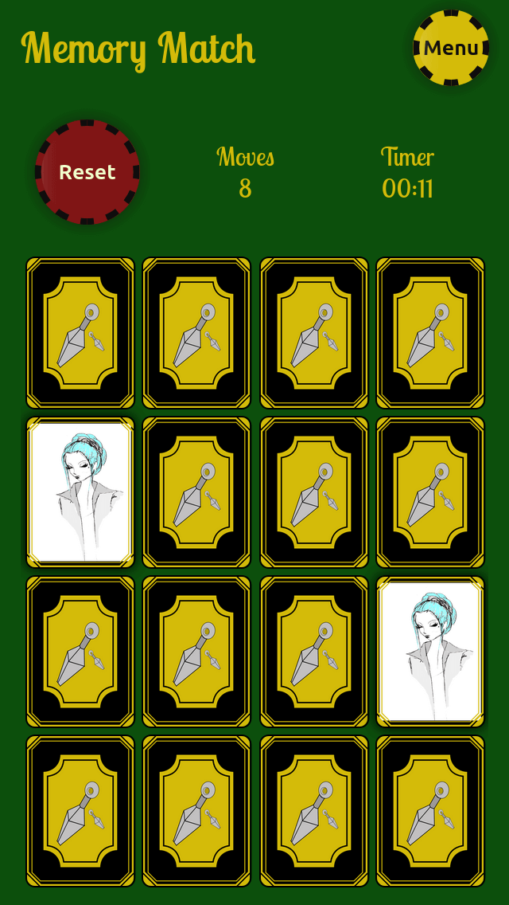
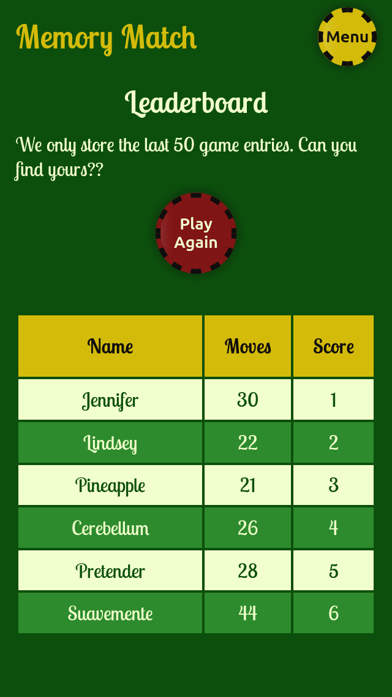
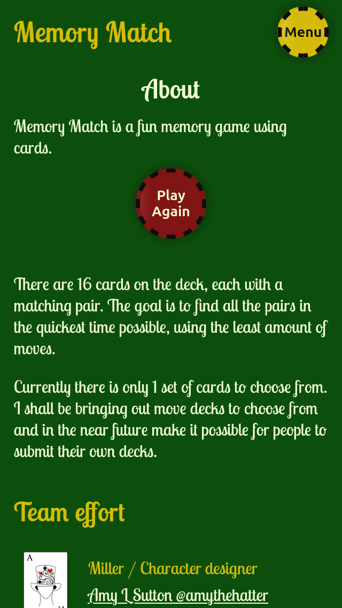
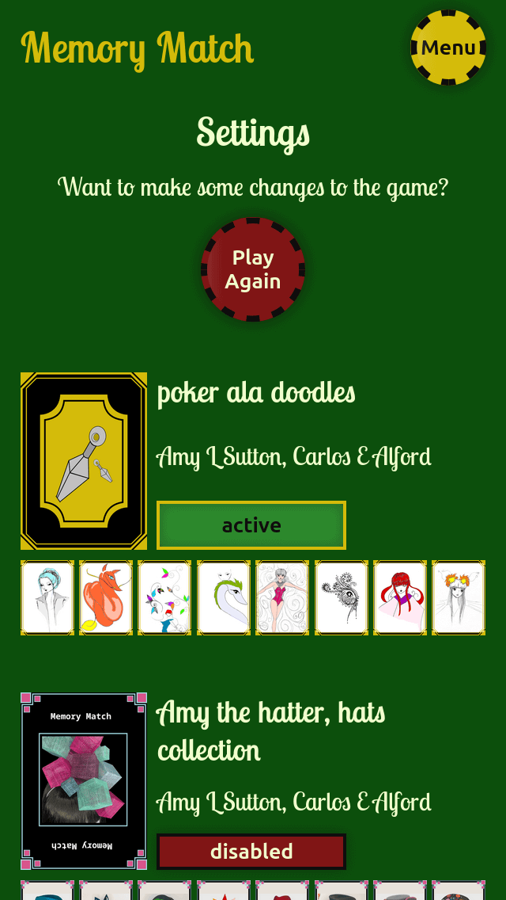
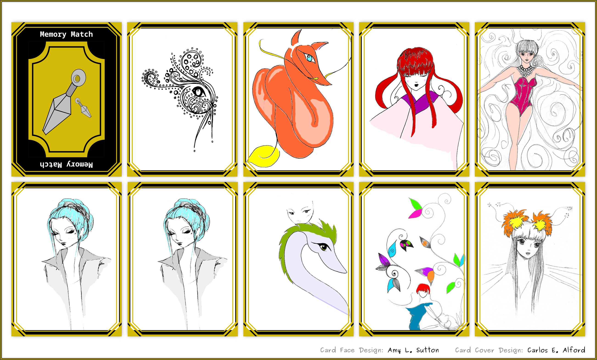

# Memory Match :video_game:

A fun memory game with cards, just find the pairs. Uses a dummy results table to compare your score.

:video_game: [Play the game](https://webshuriken.github.io/memory-match/)

## About

It is a `React` app that uses `TypeScript`. The images for the app are hosted in Cloudinary and so far their service has been fantastic.

**Home**

**Deck of Cards**

## Tech Stack

- React js
- Pure CSS (because it is sweet)
- Cloudinary
- Badwords and Badwords filter
- Inkscape

## Run Locally

The game app is live but you can also play it locally.

1. `Clone the repo`
2. inside the repo folder `npm i` to install dependencies
3. `npm start` to run the game on localhost:3000

## Features

- Timer and moves tracker
- Cards flip on click
- Settings allow for selection of different deck of cards
- Leaderboard that shows the top 30 scores, currently locally only
- Unit and Integrations tests. All components are tested.

## Road Aap

### Version 1.2.0

Setting page to allow a user to:
- [X] choose a deck of cards

### Version 1.3.0

Setting page to allow a user to:
- [ ] choose the difficulty (how many cards to play with).

This will affect the existing decks as they only contain 8 cards each. Having a difficulty level means adding more cards per game or we could just increase the difficulty of the actual images on the cards.

### Version 1.4.0

- [ ] Store players data in a DB so we can use this data to make the game more competitive.

Having life data that is shared across anyone playing the game would be awesome and a way for people to be competing for best score. This feature, naturally follows the difficulty level.

## Contributing

Pull requests are welcomed.

- Fork the repo
- Clone locally or not
- Create your changes
- Make a pull request

## Acknowledgements

Here are some of the npm packages I used for the project:

- [badwords-filter](https://www.npmjs.com/package/badwords-filter) An easy-to-use word filter with advanced detection techniques.
- [badwords](https://www.npmjs.com/package/badwords) A highly consumable list of bad (profanity) English words based on the nice short and simple list found in Google's "what do you love" project made accessible by Jamie Wilkinson.

## Authors

- [Amy L Sutton](https://amythehatter.com) - card designs
- [Carlos E Alford](https://carlosealford.com/) - developer

## License

[MIT](LICENSE)
